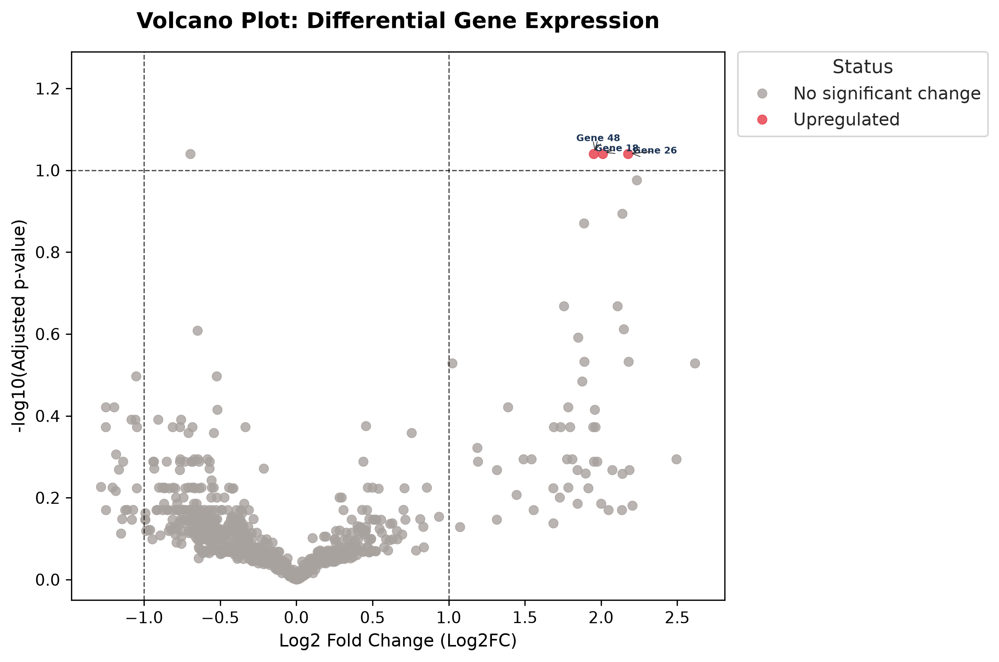

Custom End-to-End RNA-Seq Differential Gene Expression (DGE) Pipeline
A lightweight, dataset-agnostic Python pipeline designed for processing raw RNA-Seq count data, executing rigorous statistical differential expression analysis, and generating publication-grade dynamic visualizations.
This project was built from scratch without black-box statistical packages (e.g., DESeq2, edgeR) to ensure full mathematical transparency, modularity, and explicit control over normalization, variance estimation, and multiple hypothesis correction.
---
🧬 Statistical Methodology & Workflow
The pipeline consists of two primary stages: statistical differential testing (`scripts/gene\_analyze.py`) and dynamic visualization (`scripts/plot\_results.py`).
1. Data Pre-processing & Normalization
Counts Per Million (CPM): Adjusts raw read counts for varying sequencing depths across biological replicates:
$$\text{CPM}{i, j} = \left( \frac{c{i, j}}{\sum_{k} c_{k, j}} \right) \times 10^6$$
Log2 Fold Change ($\text{Log}_2\text{FC}$): Quantifies relative expression shifts between control and treatment groups. A pseudocount ($\epsilon = 1.0$) is added to smooth zero counts prior to transformation:
$$\text{Log}2\text{FC}i = \log_2(\bar{x}{\text{treated}, i} + \epsilon) - \log_2(\bar{x}{\text{control}, i} + \epsilon)$$
2. Hypothesis Testing & Multiple Testing Correction
Welch’s t-Test: Evaluates differential expression per gene without assuming equal population variances between sample conditions.
Benjamini-Hochberg (BH) FDR Adjustment: Adjusts $p$-values to control the False Discovery Rate across thousands of simultaneous tests:
$$P_{(i)}^{\text{adj}} = \min \left( P_{(i)} \cdot \frac{m}{i}, P_{(i+1)}^{\text{adj}} \right)$$
3. Differential Significance Criteria
Upregulated: $\text{Log}_2\text{FC} \ge 1.0$ AND $\text{Adjusted } p\text{-value} \le 0.10$
Downregulated: $\text{Log}_2\text{FC} \le -1.0$ AND $\text{Adjusted } p\text{-value} \le 0.10$
No Significant Change: Fails either or both magnitude and significance thresholds.
---
📊 Publication-Quality Visualization
The `plot\_results.py` script renders non-overlapping volcano plots with dynamic axis scaling, customized color palettes, and label collision avoidance powered by `adjustText`.

---
📂 Repository Structure
```text
.
├── scripts/
│   ├── generate\_data.py   # Generates simulated count matrices for testing
│   ├── gene\_analyze.py    # Main statistical DGE execution pipeline
│   └── plot\_results.py    # Dynamic, publication-ready volcano plot generator
├── data/
│   ├── gene\_counts.csv    # Raw count matrix input
│   └── dge\_results.csv   # Statistical outputs (Log2FC, p-values, padj, status)
├── volcano\_plot.png       # Rendered visualization figure
├── requirements.txt       # Python environment dependencies
└── README.md              # Project documentation
```
---
🚀 Execution Guide
1. Requirements & Dependencies
Ensure you have Python 3.8+ installed along with the required scientific libraries:
```bash
pip install pandas numpy scipy matplotlib seaborn adjustText
```
2. Running the Pipeline
(Optional) Generate Mock Data:
```bash
   python3 generate\_data.py
   ```
Execute DGE Analysis:
```bash
   python3 gene\_analyze.py
   ```
Generates `dge\_results.csv` containing normalized metrics, test statistics, and significance annotations.
Generate Publication Plot:
```bash
   python3 plot\_results.py
   ```
Generates `volcano\_plot.png` ready for publication or presentation.
---
🛠️ Stack
Language: Python 3
Scientific Computing: `pandas`, `numpy`, `scipy`
Data Visualization: `matplotlib`, `seaborn`, `adjustText`
Environment: Linux / WSL2
